# Operation IRONSPINE

**Threat Hunt Report | Operation IRONSPINE | Linux Supply Chain Compromise**

**Environment:** Simulated SOC investigation in an Azure cyberrange  
**Platform:** Microsoft Sentinel / Azure Log Analytics  
**Investigation window:** October 24, 2026, 14:00–16:00 UTC  
**Organization:** NovaBridge Analytics  
**Affected hosts:** `nb-cicd01` (`10.7.0.10`), `nb-app01` (`10.7.0.20`)  
**Downstream impacted host:** `nb-db01` (`10.7.0.30`)

---

## Table of Contents

1. [Executive Summary](#executive-summary)
2. [Hunt Scope and Trigger](#hunt-scope-and-trigger)
3. [Key Findings](#key-findings)
4. [Attack Timeline](#attack-timeline)
5. [Technical Analysis](#technical-analysis)
   - [Initial Access and Dependency Compromise](#initial-access-and-dependency-compromise)
   - [Payload Delivery and Execution](#payload-delivery-and-execution)
   - [Lateral Propagation Through CI/CD](#lateral-propagation-through-cicd)
   - [Production Execution and Credential Access](#production-execution-and-credential-access)
   - [Persistence](#persistence)
   - [Outbound Communication and Payload Visibility](#outbound-communication-and-payload-visibility)
   - [Network Baseline and Traffic Discrimination](#network-baseline-and-traffic-discrimination)
   - [Database Reconnaissance and Data at Risk](#database-reconnaissance-and-data-at-risk)
   - [Supply Chain Root Cause and Attribution](#supply-chain-root-cause-and-attribution)
   - [Legitimate Activity and Application Noise](#legitimate-activity-and-application-noise)
6. [Indicators of Compromise](#indicators-of-compromise)
7. [MITRE ATT&CK Mapping](#mitre-attck-mapping)
8. [Detection Opportunities](#detection-opportunities)
9. [Recommended Actions](#recommended-actions)

---

## Executive Summary

A process monitor identified abnormal CPU and memory consumption on NovaBridge Analytics' production application server, `nb-app01`, accompanied by an unexpected Python subprocess and an outbound connection outside the reported LiteLLM proxy configuration. The investigation traced the activity to an automated dependency update on the CI/CD runner, `nb-cicd01`, which upgraded LiteLLM from version 1.82.6 to the compromised release 1.82.8.

The package installation created a Python startup trigger. A subsequent test process spawned the backdoor on the runner. The same pipeline then built and deployed a Docker image to production, where the backdoor executed again approximately 11 minutes after the package upgrade. On `nb-app01`, the malicious process targeted environment variables and credential files, established systemd user-service persistence, and connected to an anomalous external address. PostgreSQL audit records subsequently showed catalogue enumeration and bulk-read statements associated with suspected abuse of the application database account.

The evidence establishes malicious execution on both the CI/CD runner and production server, persistence on production, and suspicious downstream database activity. The network records do not reveal the encrypted payload or establish which credential values were transferred, and the SQL logs do not establish the number of records retrieved. Response priorities are to contain the affected systems, revoke exposed credentials, rebuild from trusted artifacts, assess customer data exposure, and enforce dependency and deployment integrity controls.

---

## Hunt Scope and Trigger

At approximately 15:00 UTC, the production process monitor reported resource exhaustion during application startup. Operations initially attributed the activity to a container restart storm during a routine deployment. The investigation tested the software supply chain hypothesis and traced the resulting execution, production deployment, credential access, persistence, outbound traffic, and database activity. The provided evidence supports a compromise but does not independently quantify the cause of the resource spike or establish the number of container restarts.

| Item | Scope |
|---|---|
| Organization | NovaBridge Analytics (`novabridge.io`) |
| Primary systems | `nb-cicd01` (`10.7.0.10`), self-hosted GitHub Actions runner; `nb-app01` (`10.7.0.20`), production analytics API and LiteLLM proxy |
| Internal system | `nb-db01` (`10.7.0.30`), PostgreSQL 15 database server |
| Operating system | Ubuntu 22.04 on all three hosts |
| Workspace | `LAW-HuntPractice` |
| Analysis window | 24 October 2026, 14:00 to 16:00 UTC |
| Run identifier | `is-214-20261024` |
| Telemetry | CI/CD pipeline, package audit, endpoint process/file/network events, PostgreSQL Syslog; logon telemetry available but not independently queried |

The investigation used KQL to correlate package changes, pipeline steps, process ancestry, file creation, network connections, and PostgreSQL audit events. Custom tables were scoped with `RunId`; Syslog was scoped with `RunId_CF`. The [queries directory](queries/) contains the executed searches reproduced below. The [evidence directory](evidence/) contains the original evidence screenshots. Raw query exports used during analysis are retained privately and are not included in the public repository. The March 2026 public LiteLLM incident provides threat intelligence context for this simulated October 2026 incident.

---

## Key Findings

| Area | Finding |
|---|---|
| Initial access | The `weekly-dependency-update` job installed LiteLLM 1.82.8 from PyPI on `nb-cicd01`, replacing 1.82.6. |
| Execution | Pip created `litellm_init.pth`; a legitimate pytest process subsequently spawned a Python subprocess executing Base64-decoded content. |
| Lateral propagation | Docker build, push, and production deployment steps were followed by the same execution pattern on `nb-app01`. |
| Credential access and persistence | The production backdoor targeted environment variables and four credential-related files, created a Python script and systemd user unit, and initiated service activation. |
| Outbound communication | The anomalous address appeared after backdoor execution; all seven observed port-443 events were attributed to the original backdoor or the persistence process. |
| Database access | PostgreSQL audit records show non-baseline catalogue queries, broad reads, and a customer-table export statement. The source and timing support abuse of the application service account. |

---

## Attack Timeline

All times below are UTC on 24 October 2026.

| Time | Activity |
|---|---|
| 14:15:00 | The weekly dependency update checks out commit `a3f7c1e`. |
| 14:15:22–14:15:26 | Pip reports installation of LiteLLM 1.82.8; package audit records the upgrade and endpoint telemetry records creation of the `.pth` trigger. |
| 14:22:47–14:22:49 | The CI/CD runner starts pytest, followed by the suspicious Python child process (PID 3021). |
| 14:24:21 | The pipeline reports successful completion of its test step. |
| 14:25:32–14:25:43 | The job builds and pushes the Docker image, then deploys it to production. |
| 14:26:38–14:26:43 | Gunicorn starts on `nb-app01`; the backdoor appears as Python PID 3061. |
| 14:26:44–14:26:49 | The production backdoor launches environment enumeration and four credential-file access commands. |
| 14:26:50 | PID 3061 establishes a connection to `198.51.100.44:443`. |
| 14:26:53–14:27:06 | The backdoor creates persistence artifacts and initiates systemd service activation. |
| 14:28:44 | Systemd launches the persistence script as Python PID 3070. |
| 14:28:50–14:28:56 | The database records a connection from `10.7.0.20`, authorization of `app_svc`, and the first suspicious catalogue queries. |
| 14:31:56–14:35:39 | Broad reads, additional catalogue enumeration, and a customer-table CSV export statement appear in PostgreSQL audit records. |
| 15:00 | Last observed port-443 network event to the anomalous address on `nb-app01`. |

---

## Technical Analysis

### Initial Access and Dependency Compromise

The CI/CD pipeline's `weekly-dependency-update` job reported successful installation of LiteLLM 1.82.8 at 14:15:22 UTC. Package audit telemetry independently recorded the upgrade from 1.82.6 to 1.82.8 at 14:15:25.283, with PyPI identified as the source. The 3.283-second gap between the records corroborates the automated installation. It is not a measurement of the entire installation duration or, by itself, proof that no human approval occurred.

The hunt identifies the job as an unreviewed dependency upgrade that selected the newest release. Public reporting identifies 1.82.7 and 1.82.8 as backdoored versions; only 1.82.8 was observed in the local package audit. The legitimate installation mechanism delivered the compromised dependency without requiring a direct exploit against NovaBridge's runner.

#### Pipeline Job and Installation Evidence

<a id="pipeline-installation-evidence"></a>

```kql
CICDPipeline_CL
| where RunId == "is-214-20261024"
| where TimeGenerated between (datetime(2026-10-24 14:00:00) .. datetime(2026-10-24 16:00:00))
| where Computer == "nb-cicd01"
| where StepOutput contains "litellm"
| project TimeGenerated, Computer, JobName, StepName, StepOutput
| order by TimeGenerated asc
```

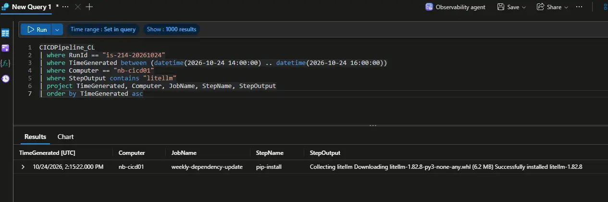

*CI/CD pipeline output identifying the weekly dependency update and installation of LiteLLM 1.82.8.*

#### Package Version Change

<a id="package-upgrade-evidence"></a>

```kql
PackageAudit_CL
| where RunId == "is-214-20261024"
| where TimeGenerated between (datetime(2026-10-24 14:00:00) .. datetime(2026-10-24 16:00:00))
| where Computer == "nb-cicd01"
| where PackageName =~ "litellm"
| project TimeGenerated, Computer, PackageName, PreviousVersion, Version, Action, Source
| order by TimeGenerated asc
```

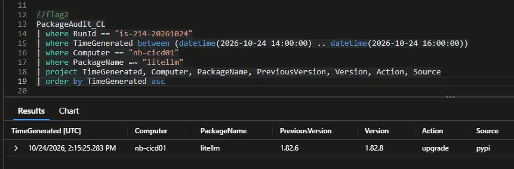

*Package audit event confirming the upgrade from LiteLLM 1.82.6 to 1.82.8 from PyPI.*

---

### Payload Delivery and Execution

#### Trigger File and Delivery Process

At 14:15:26.186 UTC, endpoint file telemetry recorded creation of `/opt/venv/lib/python3.11/site-packages/litellm_init.pth`. The initiating process was `pip` (PID 3010). This event, together with the [package installation](#package-upgrade-evidence), links the trigger to the legitimate package manager. Python normally processes applicable `.pth` files during interpreter startup; executable statements in the malicious file provide an automatic trigger within the affected environment.

<a id="startup-trigger-evidence"></a>

```kql
DeviceFileEvents_CL
| where RunId == "is-214-20261024"
| where Timestamp between (datetime(2026-10-24 14:00:00) .. datetime(2026-10-24 16:00:00))
| where DeviceName == "nb-cicd01"
| where FolderPath contains "site-packages"
| where FileName endswith ".pth"
| project Timestamp, DeviceName, FileName, FolderPath, ActionType, InitiatingProcessFileName, InitiatingProcessId
| order by Timestamp asc
```

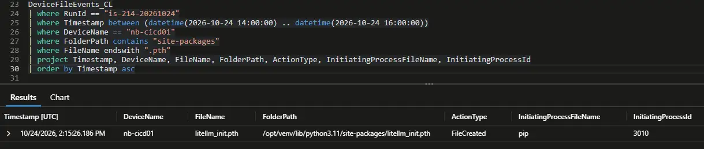

*Pip creating the LiteLLM startup trigger inside the Python virtual environment.*

#### First Backdoor Execution

At 14:22:47 UTC, the CI/CD runner's `Runner.Listener` process (PID 2100) launched pytest under Python PID 3020. At 14:22:49.205, that process spawned Python PID 3021 under the `runner` account. The child's command line invokes execution of Base64-decoded content, unlike the surrounding formatting and test commands. The visible encoded value is a placeholder rather than a recoverable complete payload.

#### Execution Delay

The time from the package upgrade to first observed backdoor execution was 7 minutes 23.922 seconds. Earlier Python formatting checks and unit tests had been launched from Bash shells without the same observed child process. The most likely explanation is that the pipeline's pytest process loaded the affected virtual environment. The records do not identify every interpreter's loaded environment or directly record `.pth` evaluation.

<a id="cicd-execution-evidence"></a>

```kql
DeviceProcessEvents_CL
| where RunId == "is-214-20261024"
| where Timestamp between (datetime(2026-10-24 14:15:26.186) .. datetime(2026-10-24 16:00:00))
| where DeviceName == "nb-cicd01"
| where FileName startswith "python"
    or InitiatingProcessFileName startswith "python"
| project Timestamp, DeviceName, FileName,
    ProcessCommandLine, ProcessId, AccountName,
    InitiatingProcessFileName, InitiatingProcessId,
    InitiatingProcessCommandLine
| order by Timestamp asc
```

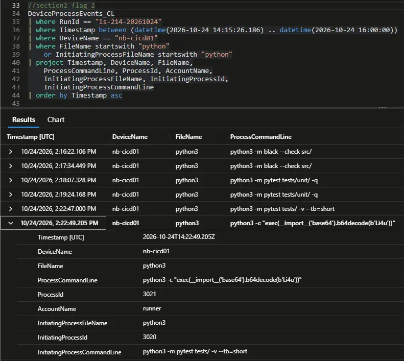

*Expanded process event showing the encoded Python subprocess (3021) parented by pytest (3020).*

---

### Lateral Propagation Through CI/CD

#### Docker Build and Production Deployment

The [pipeline job](#pipeline-installation-evidence) continued through testing, reporting six tests passed and none failed at 14:24:21.800. The subsequent `docker-build`, `docker-push`, and `deploy-production` steps completed at 14:25:32.453, 14:25:38.128, and 14:25:43.500 UTC. All three events share the original job name, repository `NovaBridge/analytics-platform`, and commit `a3f7c1e`. The build installed dependencies from the requirements file; the image was pushed to the internal registry under `analytics-api:latest`, then deployed to `nb-app01`.

The pipeline records establish the delivery sequence but do not expose a complete image digest or independently identify every dependency inside the image. The production process evidence in the [following section](#production-execution-evidence) corroborates the downstream execution of the backdoor. The deployment itself is the supported propagation mechanism; a separate lateral exploit is not required to explain the observed events.

<a id="deployment-evidence"></a>

```kql
CICDPipeline_CL
| where RunId == "is-214-20261024"
| where TimeGenerated between (datetime(2026-10-24 14:00:00) .. datetime(2026-10-24 16:00:00))
| where Computer == "nb-cicd01"
| project TimeGenerated, Computer, JobName,
    JobStatus, StepName, StepOutput, Repository, CommitSha
| order by TimeGenerated asc
```

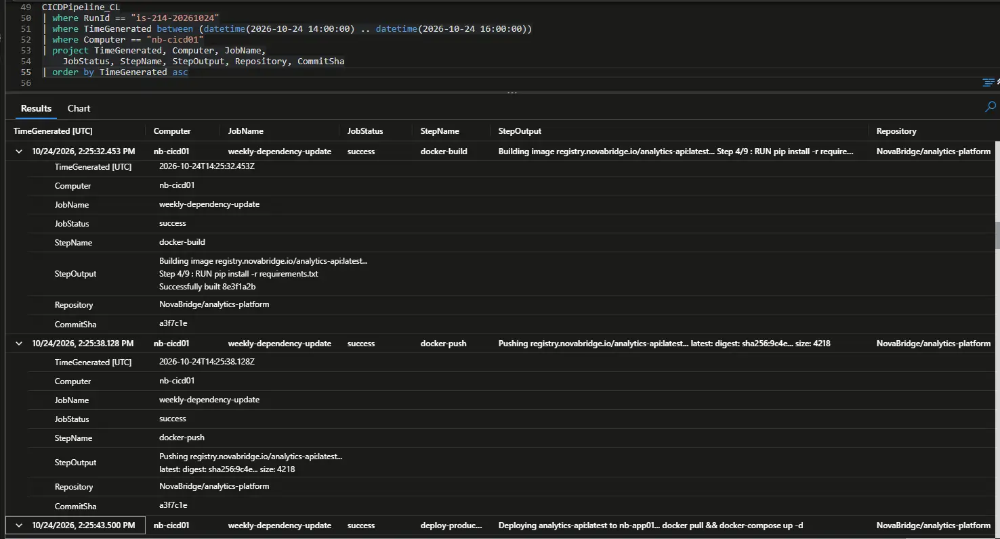

*Expanded Docker build and registry push events from the compromised dependency update job.*

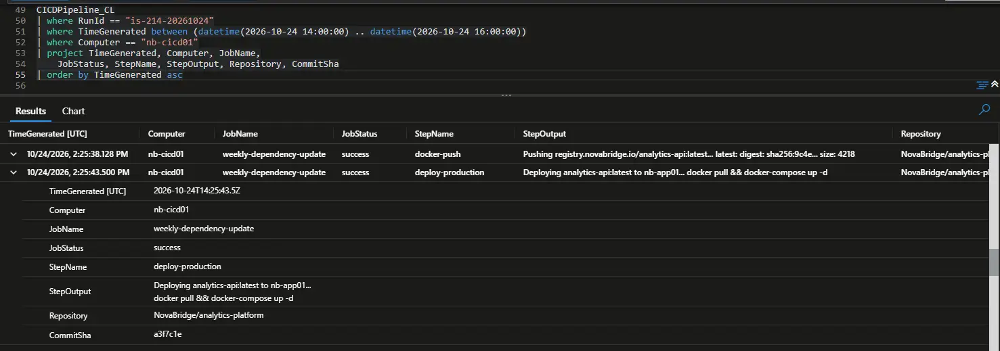

*Successful production deployment to nb-app01 under the same job and commit.*

The expanded screenshots above preserve the relevant build, push, and deployment records. Earlier production deployments preceded the compromised upgrade and establish normal deployment activity.

---

### Production Execution and Credential Access

#### Production Backdoor and Credential Access

At 14:26:38.925 UTC, Docker initiated the Gunicorn application process (PID 3060) on `nb-app01`. At 14:26:43.488, Gunicorn's Python process spawned a child (PID 3061) executing Base64-decoded content under `app_svc`. The execution pattern matches the [CI/CD runner backdoor](#cicd-execution-evidence). The new process then launched `env` and four `cat` commands, all attributed to PID 3061.

| Time (UTC) | File targeted | Potential exposure |
|---|---|---|
| 14:26:45.296 | `/srv/analytics/.env` | Application secrets, including the reported database connection string and customer encryption key |
| 14:26:45.985 | `/home/app_svc/.aws/credentials` | AWS access credentials |
| 14:26:47.530 | `/home/app_svc/.docker/config.json` | Registry authentication configuration |
| 14:26:49.753 | `/srv/analytics/.git/config` | Repository configuration and potentially credential-bearing URLs |

The hunt identifies `DATABASE_URL` and `CUSTOMER_ENCRYPTION_KEY` as production application secrets. Process events establish the targeted paths and their malicious parent, but not the file contents, successful reads, or secret values. The production environment therefore presents a greater potential customer-data impact than the original CI/CD runner.

<a id="production-execution-evidence"></a>

```kql
DeviceProcessEvents_CL
| where RunId == "is-214-20261024"
| where Timestamp between (datetime(2026-10-24 14:25:43.500) .. datetime(2026-10-24 16:00:00))
| where DeviceName == "nb-app01"
| where FileName startswith "python"
    or InitiatingProcessFileName startswith "python"
| project Timestamp, DeviceName, FileName,
    ProcessCommandLine, ProcessId, AccountName,
    InitiatingProcessFileName, InitiatingProcessId,
    InitiatingProcessCommandLine
| order by Timestamp asc
```

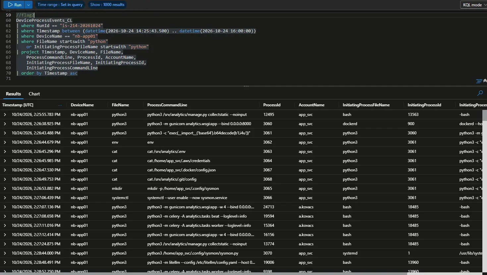

*Production process lineage showing Gunicorn, the encoded Python subprocess, credential targeting, and subsequent persistence activity.*

#### Propagation Timing and End-to-End Compromise

The interval from first observed backdoor execution on `nb-cicd01` to first observed execution on `nb-app01` was 3 minutes 54.283 seconds. The end-to-end interval from the [completed package upgrade](#package-upgrade-evidence) to [production execution](#production-execution-evidence) was 11 minutes 18.205 seconds. Both measurements reuse the earlier event records rather than additional queries. The first observed subprocess is a proxy for the trigger firing, not a direct trace of Python reading the `.pth` file.

The pipeline's normal build and deployment workflow carried the compromise into production within minutes, despite successful test results.

---

### Persistence

#### Persistence Artifacts and Service Activity

Following credential targeting, the production backdoor created two files attributed to Python PID 3061: `/home/app_svc/.config/sysmon/sysmon.py` at 14:26:58.859 and `/home/app_svc/.config/systemd/user/sysmon.service` at 14:27:02.989. The [earlier process results](#production-execution-evidence) show the same backdoor initiating a service activation command at 14:27:06.439 and systemd subsequently launching the Python script as PID 3070 at 14:28:44.

The script and service naming resemble the legitimate Sysmon monitoring tool, consistent with masquerading. The observed user-service mechanism does not require root privileges. File creation and subsequent systemd execution support an additional persistence mechanism beyond the original `.pth` trigger. The file contents and behavior across logout or reboot were not independently verified.

<a id="persistence-evidence"></a>

```kql
DeviceFileEvents_CL
| where RunId == "is-214-20261024"
| where Timestamp between (datetime(2026-10-24 14:26:43.488) .. datetime(2026-10-24 14:29:00))
| where DeviceName == "nb-app01"
| where InitiatingProcessId == 3061
| project Timestamp, DeviceName, FileName, FolderPath,
    ActionType, InitiatingProcessFileName, InitiatingProcessId
| order by Timestamp asc
```

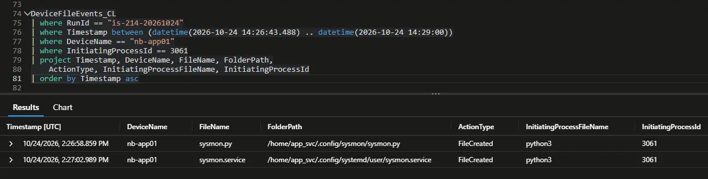

*Both production persistence files created by the identified backdoor process (PID 3061).*

---

### Outbound Communication and Payload Visibility

#### Exfiltration Destination

At 14:26:50.702 UTC, approximately seven seconds after the production backdoor appeared, `nb-app01` recorded a successful TCP connection to `198.51.100.44:443` from Python PID 3061. The connection followed the credential-file targeting activity. The hunt's proxy alert identified the address as `models.litellm.cloud`, a domain presented as resembling legitimate LiteLLM infrastructure. The destination was absent from the reported proxy configuration. The network table contains IP addresses rather than DNS or proxy configuration records, so the domain association comes from the hunt's alert rather than the query itself.

<a id="outbound-connection-evidence"></a>

```kql
DeviceNetworkEvents_CL
| where RunId == "is-214-20261024"
| where Timestamp between (datetime(2026-10-24 14:25:43.500) .. datetime(2026-10-24 16:00:00))
| where DeviceName == "nb-app01"
| project Timestamp, DeviceName, LocalIP, RemoteIP,
    RemotePort, Protocol, ActionType,
    InitiatingProcessFileName, InitiatingProcessId,
    InitiatingProcessFolderPath, InitiatingProcessAccountName
| order by Timestamp asc
```

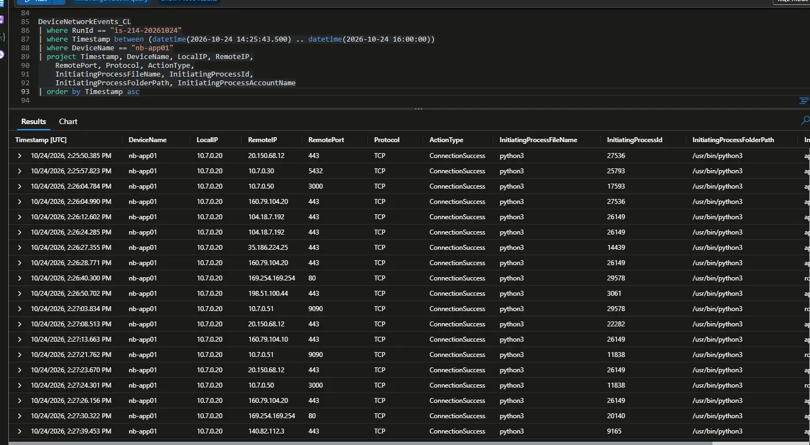

*Successful outbound TCP/443 connection from the production backdoor, identified by its initiating process ID.*

#### Fake Endpoint and Baseline Comparison

A destination baseline was constructed across the full hunt window, using the period before the first observed production backdoor execution as the lead-in. The anomalous address had zero records in the lead-in and seven port-443 events overall: one attributed to PID 3061 and six to PID 3070, the [systemd-launched persistence process](#persistence-evidence). Ordinary destinations were already present before the compromise and did not share those process IDs. This disconfirms the claim that the address should be considered legitimate based on its domain name or port.

<a id="network-baseline-evidence"></a>

```kql
DeviceNetworkEvents_CL
| where RunId == "is-214-20261024"
| where Timestamp between (datetime(2026-10-24 14:00:00) .. datetime(2026-10-24 16:00:00))
| where DeviceName == "nb-app01"
| where RemotePort == 443
| summarize
    FirstSeen = min(Timestamp),
    LastSeen = max(Timestamp),
    TotalConnections = count(),
    BaselineConnections = countif(Timestamp < datetime(2026-10-24 14:26:43.488)),
    BackdoorConnections = countif(InitiatingProcessId == 3061),
    PersistenceConnections = countif(InitiatingProcessId == 3070),
    ProcessIDs = make_set(InitiatingProcessId)
    by RemoteIP
| order by TotalConnections desc
```

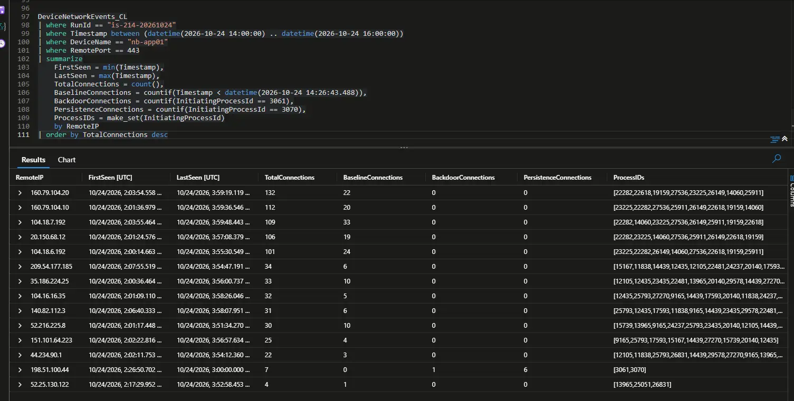

*Destination baseline showing zero pre-execution events for the anomalous address and all seven events attributed to the two malicious process IDs.*

#### Payload Encryption and Visibility

Public malware analysis by [Semgrep](https://semgrep.dev/blog/2026/the-teampcp-credential-infostealer-chain-attack-reaches-pythons-litellm/) identifies AES-256-CBC encryption with RSA-4096 protection of the encryption key. The supplied network telemetry contains endpoint addresses, ports, connection outcomes, and process attribution, but no payload bytes, transferred byte counts, or decryption material. It therefore cannot identify which secrets were transmitted. The preceding collection activity and network connections support suspected credential exfiltration; they do not independently establish the contents or successful delivery of a particular encrypted payload.

---

### Network Baseline and Traffic Discrimination

#### Legitimate Destination Count

The production server routinely communicates with model providers and other services. A distinct-address search excluding `10.0.0.0/8` and the anomalous destination returned 14 addresses: 13 also present in the port-443 baseline and the link-local metadata endpoint `169.254.169.254`, previously observed on port 80. The hunt identifies five model-provider brands behind multiple edge IPs. The count establishes the observed destination population, not a complete or verified historical allowlist.

<a id="destination-count-evidence"></a>

```kql
DeviceNetworkEvents_CL
| where RunId == "is-214-20261024"
| where Timestamp between (datetime(2026-10-24 14:00:00) .. datetime(2026-10-24 16:00:00))
| where DeviceName == "nb-app01"
| where InitiatingProcessFileName =~ "python3"
| where not(ipv4_is_in_range(RemoteIP, "10.0.0.0/8"))
| where RemoteIP != "198.51.100.44"
| distinct RemoteIP
| summarize DestinationCount = count(),
    Destinations = make_set(RemoteIP)
```

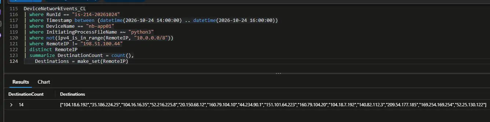

*Fourteen distinct destinations remaining after exclusion of the internal network and anomalous IP.*

#### Traffic Discriminator

A second comparison tested whether fixed-interval beaconing or the execution account could distinguish the traffic. The seven anomalous destination events had inter-event gaps ranging from 1.789 to 1,460.332 seconds; the gaps did not support a fixed-interval pattern across the combined traffic. Both malicious and ordinary processes used `python3`, TCP/443, and the `app_svc` account. Low event volume was also insufficient: another destination recorded only four events.

Process identity and ancestry provided the stronger discriminator. The anomalous destination was contacted only by PIDs 3061 and 3070 in the observed summary, while the regular proxy traffic came from other Python workers. This attribution is more meaningful than port or executable name alone. The [first-seen baseline](#network-baseline-evidence) provides an independent temporal discriminator. The specific PIDs are incident-local values, not durable detection signatures. The interval calculation combines events from different processes and does not exclude a different periodic pattern within an individual process. These summaries count network records without filtering for connection success.

<a id="traffic-discriminator-evidence"></a>

```kql
DeviceNetworkEvents_CL
| where RunId == "is-214-20261024"
| where Timestamp between (datetime(2026-10-24 14:00:00) .. datetime(2026-10-24 16:00:00))
| where DeviceName == "nb-app01"
| where InitiatingProcessFileName =~ "python3"
| where RemotePort == 443
| sort by RemoteIP asc, Timestamp asc
| serialize
| extend GapSeconds = iff(RemoteIP == prev(RemoteIP),
    round((Timestamp - prev(Timestamp)) / 1s, 3),
    real(null))
| summarize
    TotalConnections = count(),
    MinGapSeconds = min(GapSeconds),
    MaxGapSeconds = max(GapSeconds),
    GapSamples = make_list(GapSeconds, 10),
    Accounts = make_set(InitiatingProcessAccountName),
    ProcessIDs = make_set(InitiatingProcessId)
    by RemoteIP
| order by TotalConnections desc
```

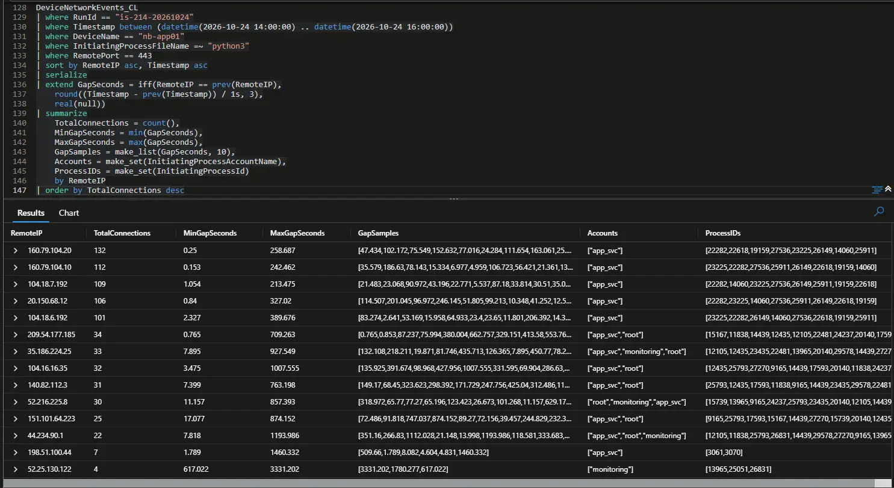

*Traffic comparison showing variable connection intervals, shared execution accounts, and distinct malicious process identities.*

---

### Database Reconnaissance and Data at Risk

#### Normal Query Baseline and Suspicious Access

PostgreSQL audit activity on `nb-db01` departed from the application's normal statement patterns. The available lead-in records contain nine distinct recurring statement templates, including health checks, parameterized customer-specific retrieval, routine writes, and time-bounded aggregations. At 14:28:50.204 UTC, PostgreSQL recorded a connection from the production server (`10.7.0.20`). At 14:28:51.179, the `app_svc` account was authorized to access `novabridge`. Four seconds later, previously unseen catalogue queries appeared.

#### Database Query Source

The observed source and timing, combined with the [production credential targeting](#production-execution-evidence), support abuse of the database credentials in `DATABASE_URL`. The hunt's confirmation further attributes the connection to the persistence script, PID 3070, contacting `10.7.0.30:5432` at 14:28:47 and reports no anomalous SSH logons to the database host. These additional details are hunt-provided corroboration: the process-to-network join and logon validation query were not independently executed. The Syslog messages lack a shared session identifier linking the connection, authentication, and individual statements, so their specific association is inferred from timing and context.

<a id="database-audit-evidence"></a>

```kql
Syslog
| where RunId_CF == "is-214-20261024"
| where TimeGenerated between (datetime(2026-10-24 14:00:00) .. datetime(2026-10-24 16:00:00))
| where Computer == "nb-db01"
| project TimeGenerated, Computer, ProcessName,
    SyslogMessage, Facility, SeverityLevel
| order by TimeGenerated asc
```

*The database findings below were transcribed from the privately retained results of this query. The working export contained 1,000 records, including 721 PostgreSQL records, and ended at 15:26:45.582 UTC; it did not cover the full requested window. Targeted workspace screenshots for this phase remain outstanding.*

| Time (UTC) | Audit observation |
|---|---|
| 14:28:50.204 | Connection received from `10.7.0.20`, source port 51200 |
| 14:28:51.179 | Connection authorized for `app_svc`, database `novabridge` |
| 14:28:55.433 | Public-schema table enumeration via `information_schema.tables` |
| 14:28:56.423 | Table statistics and estimated row counts via `pg_stat_user_tables` |
| 14:31:56.423–14:32:03.287 | Broad reads targeting customers, analytics results, and user accounts |
| 14:32:08.935–14:32:10.466 | Customer and analytics column names and data types via `information_schema.columns` |
| 14:32:14.000 | Login-capable roles queried via `pg_catalog.pg_roles` |
| 14:35:26.326 | Non-revoked API key records targeted |
| 14:35:30.227 | Customer-table COPY statement requesting CSV output |
| 14:35:39.288 | Broad analytics results read requesting up to 10,000 rows |

*Selected audit observations transcribed from the working query results; a targeted workspace screenshot has not yet been captured.*

#### Attacker Query Characteristics and Data at Risk

The two distinguishing characteristics are system catalogue reconnaissance and bulk-read statements. The former maps database schemas, tables, columns, estimated table sizes, and login roles. The latter departs from the application's normal targeted query templates and places customer and account information at risk. The `COPY` statement indicates attempted bulk extraction to the database client; it does not establish a completed transfer outside the environment. SQL logs do not include returned rows or prove how many records the attacker retrieved.

---

### Supply Chain Root Cause and Attribution

The simulated incident reflects the reported March 2026 compromise of LiteLLM. [Semgrep's analysis](https://semgrep.dev/blog/2026/the-teampcp-credential-infostealer-chain-attack-reaches-pythons-litellm/) describes the upstream GitHub Actions credential compromise involving Trivy and hackerbot-claw. The [Cloud Security Alliance research note](https://labs.cloudsecurityalliance.org/research/csa-research-note-litellm-pypi-backdoor-ai-toolchain-supply/) traces the likely theft of LiteLLM's publishing credential to a poisoned Trivy action running in its CI pipeline. [Datadog Security Labs](https://securitylabs.datadoghq.com/articles/litellm-compromised-pypi-teampcp-supply-chain-campaign/) associates the two unauthorized releases on March 24 with the broader TeamPCP campaign.

In the lab, the [dependency upgrade](#package-upgrade-evidence), [startup trigger](#startup-trigger-evidence), [CI/CD execution](#cicd-execution-evidence), and [production deployment](#deployment-evidence) establish the downstream chain. The absence of effective dependency approval and integrity gates is the contributing control failure identified by the hunt. The upstream compromise is externally reported, not independently observed in NovaBridge's logs. The relationship between hackerbot-claw and TeamPCP remains uncertain; the evidence does not establish whether the same operator controlled both.

---

### Legitimate Activity and Application Noise

Successful production deployments were already present before the compromised package upgrade. Routine Python formatting checks and automated tests were also visible before the first observed malicious child process. Normal database activity included connection authorization, maintenance tasks, health checks, and targeted statements. These behaviors were not classified as malicious solely because they used the same tools, accounts, or systems.

The [destination baseline](#network-baseline-evidence) and [traffic comparison](#traffic-discriminator-evidence) distinguish regular provider traffic from the anomalous destination using first-seen timing and process attribution. The original hypothesis of a container restart storm was not independently verified, and the observed backdoor sequence provides a distinct explanation for the suspicious activity. The available logs establish neither the precise CPU and memory impact nor the total restart count.

---

## Indicators of Compromise

| Indicator | Significance |
|---|---|
| `litellm 1.82.8` | Compromised version observed on the CI/CD runner |
| `litellm 1.82.7` | Additional compromised version identified in public reporting; not observed locally |
| `/opt/venv/lib/python3.11/site-packages/litellm_init.pth` | Python startup trigger created by pip |
| `python3` executing Base64-decoded content | Suspicious execution pattern associated with pytest and Gunicorn |
| `/home/app_svc/.config/sysmon/sysmon.py` | Production persistence script |
| `/home/app_svc/.config/systemd/user/sysmon.service` | Systemd user-service persistence artifact |
| `models.litellm.cloud` | Masquerading destination identified by the hunt alert |
| `198.51.100.44:443` | Anomalous simulated outbound destination associated with both malicious process IDs |
| `app_svc` catalogue enumeration and bulk reads | Behavioral indicator of suspected database account abuse |

The PIDs used throughout the investigation are local correlation keys, not persistent IOCs. The external IP is from a documentation-reserved address range and is a cyberrange indicator; it should not be treated as a verified real-world malicious address. The domain is recorded as supplied by the hunt, rather than independently resolved from local network data.

---

## MITRE ATT&CK Mapping

| Tactic | Technique | ID | Observed activity |
|---|---|---|---|
| Initial Access | Supply Chain Compromise: Compromise Software Supply Chain | [T1195.002](https://attack.mitre.org/techniques/T1195/002/) | Compromised dependency installed and propagated through the legitimate deployment pipeline |
| Execution | Command and Scripting Interpreter: Python | [T1059.006](https://attack.mitre.org/techniques/T1059/006/) | Python startup trigger and encoded subprocess execution |
| Credential Access | Unsecured Credentials: Credentials In Files | [T1552.001](https://attack.mitre.org/techniques/T1552/001/) | Backdoor launches commands targeting application, cloud, registry, and Git configuration files |
| Persistence | Create or Modify System Process: Systemd Service | [T1543.002](https://attack.mitre.org/techniques/T1543/002/) | User-service artifacts and subsequent systemd-launched Python process |
| Defense Evasion | Masquerading: Match Legitimate Resource Name or Location | [T1036.005](https://attack.mitre.org/techniques/T1036/005/) | Sysmon-like naming and reported lookalike endpoint |
| Command and Control | Encrypted Channel: Symmetric Cryptography | [T1573.001](https://attack.mitre.org/techniques/T1573/001/) | AES-256-CBC payload encryption reported in malware analysis; not independently identified in captured traffic |
| Exfiltration | Exfiltration Over C2 Channel | [T1041](https://attack.mitre.org/techniques/T1041/) | Malicious outbound communication following credential targeting; exact data transfer not established |
| Initial Access / Defense Evasion | Valid Accounts | [T1078](https://attack.mitre.org/techniques/T1078/) | Suspected abuse of the authorized application database account |
| Collection | Data from Information Repositories | [T1213](https://attack.mitre.org/techniques/T1213/) | Catalogue reconnaissance and subsequent broad PostgreSQL reads |

The hunt also maps the poisoned AI software distribution to MITRE ATLAS `AML.T0011.002`. Ordinary deployments, test processes, and provider traffic are not mapped as attacker activity unless the associated evidence establishes a connection to the compromise.

---

## Detection Opportunities

| Priority | Recommended detection | Telemetry |
|---|---|---|
| Critical | Alert on installation of reported compromised dependencies, unapproved version changes, or failed approved-manifest integrity checks. | `PackageAudit_CL`, `CICDPipeline_CL` |
| Critical | Correlate unexpected `.pth` creation in Python package directories with suspicious interpreter startup and child process behavior. | `DeviceFileEvents_CL`, `DeviceProcessEvents_CL` |
| High | Detect encoded Python execution during routine testing or application startup, especially when followed by secret-file targeting. | `DeviceProcessEvents_CL` |
| High | Identify unexpected service-unit creation and service activation in application service-account contexts. | `DeviceFileEvents_CL`, `DeviceProcessEvents_CL` |
| High | Compare outbound destinations with an established baseline and correlate newly observed destinations with anomalous process ancestry. | `DeviceNetworkEvents_CL`, `DeviceProcessEvents_CL` |
| High | Flag application service accounts performing non-baseline catalogue enumeration or bulk-read and COPY statements. | PostgreSQL Syslog, process and network telemetry |
| Medium | Correlate unapproved package upgrades with subsequent container build, registry push, and production promotion. | `CICDPipeline_CL`, `PackageAudit_CL` |

These are recommended detection opportunities, not production-validated alert rules. Historical baselines, normal service-account behavior, process lifetime identifiers, and tuning against authorized administrative operations are needed before deployment.

---

## Recommended Actions

Top five remediation actions in priority order:

1. Revoke and rotate ALL exposed credentials immediately: LLM API keys, AWS credentials, database passwords, Docker registry tokens, and the `CUSTOMER_ENCRYPTION_KEY` on nb-app01. **Risk addressed:** the attacker holds valid credentials and can use them from outside the network.

2. Remove persistence from both hosts: delete `~/.config/sysmon/sysmon.py` and `sysmon.service`, disable the systemd user service, and remove `litellm_init.pth` from site-packages. **Risk addressed:** the attacker maintains access through the persistence mechanism.

3. Pin litellm to version `1.82.6` (or a verified clean version) and block `1.82.7` and `1.82.8`. **Risk addressed:** any future pip install could pull the backdoored version again.

4. Block `models.litellm.cloud` (`198.51.100.44`) at the network perimeter. **Risk addressed:** the persistence component polls this address for follow-on payloads.

5. Gate the pipeline on hash verification against a known-good manifest and pinned versions, with dependency scanning (for example Dependabot or Snyk) before deployment. The existing security scan ran and did not see the backdoor. **Risk addressed:** future supply chain attacks pass through the pipeline undetected.
